 

### Oi, eu sou Lima.

Desenvolvedor web. Construo sites e aplicações com **TypeScript** e **Next.js**.

<!-- Adicione uma linha sua aqui, por exemplo: "Estudando ... em ..." -->

 

  

### Projetos

<table>
  <tr>
    <td width="420">
      <b><a href="https://github.com/J4aoo/Valozzi">Valozzi</a></b> 
      Site para a Valozzi · TypeScript
    </td>
  </tr>
</table>

 

### Atividade

  

<!-- Coloque seus links aqui, por exemplo:

-->

